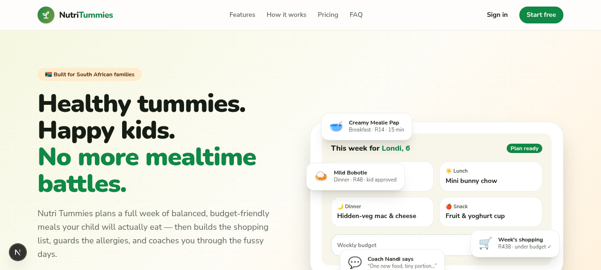
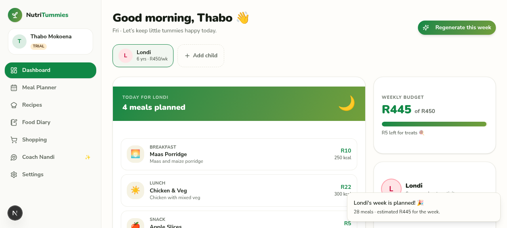
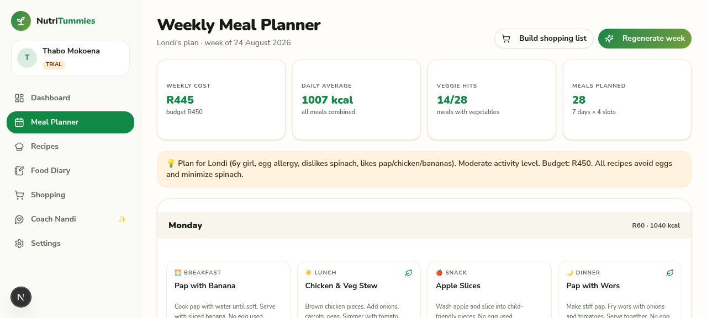
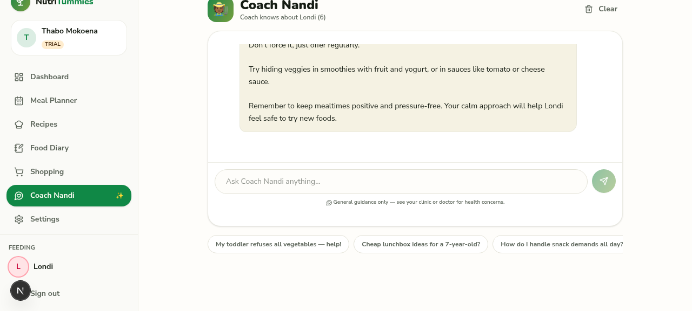

# 🥗 Nutri Tummies

**AI-powered child nutrition for South African families.** Plan a full week of budget-friendly, allergy-safe meals your kids will actually eat — in under a minute.

Nutri Tummies takes the daily stress out of feeding a family: it generates personalised 7-day meal plans around each child's age, allergies and your weekly food budget (in Rand), builds your shopping list, learns from what your kids actually ate, and gives you an AI nutrition coach in your pocket.

---

## ✨ Features

| Area | What you get |
|---|---|
| 🤖 **AI Meal Planning** | 7-day plans (breakfast, lunch, dinner, snack) tuned to age, allergies, budget and SA staples — with portions, ZAR cost estimates and nutrition notes |
| 🛒 **Smart Shopping Lists** | One tap generates a categorised shopping list from any meal plan, with running Rand totals |
| 👶 **Multi-Child Profiles** | Each child gets their own profile, allergen flags, avatar and plan |
| 🍲 **Recipe Library** | 20 South African kid-approved recipes seeded in (pap, bobotie, vetkoek, amagwinya, bunny chow, samp & more) plus AI recipe generation from what's already in your kitchen |
| 📔 **Food Diary** | Track what was actually eaten with star ratings — the AI uses this to improve future plans |
| 💬 **AI Nutrition Coach** | Ask anything about fussy eating, portion sizes, budget swaps — chat history saved |
| 💰 **Budget Guardrails** | Set a weekly food budget; plans are generated to land inside it |
| 🆓 **Freemium + 14-Day Trial** | Free tier (1 child, 1 plan), 14-day premium trial on signup, then R79/month or R790/year |
| 🔒 **POPIA-aware** | Session-cookie auth, scrypt password hashing, per-user data isolation on every API call |

## 🖼️ Screenshots

| | |
|---|---|
|  |  |
|  |  |

## 🧱 Tech Stack

- **Framework:** Next.js 16 (App Router, TypeScript)
- **Styling:** Tailwind CSS 4 + shadcn/ui, custom Nunito-based brand system
- **State:** Zustand + TanStack Query
- **Database:** Prisma ORM (SQLite in dev — swap `DATABASE_URL` to hosted Postgres for production)
- **Auth:** Custom session-cookie auth (scrypt hashing, httpOnly cookies)
- **AI:** z-ai-web-dev-sdk (GLM) with structured JSON output and deterministic fallbacks if the model is unavailable
- **Validation:** Zod on every API route

## 🚀 Getting Started

```bash
# 1. Install dependencies
bun install        # or npm install

# 2. Configure environment
cp .env.example .env   # then edit DATABASE_URL if needed

# 3. Create the database and seed the recipe library
bun run db:push
bunx tsx scripts/seed.ts

# 4. Start the dev server
bun run dev
```

Open http://localhost:3000, create an account and add your first child profile.

## 🔑 Environment Variables

| Variable | Required | Description |
|---|---|---|
| `DATABASE_URL` | ✅ | Prisma connection string. SQLite (`file:...`) for local dev, Postgres URL for production. |

## ☁️ Deploying to Vercel

1. Push this repo to GitHub and import it in Vercel.
2. Set `DATABASE_URL` in Vercel → Settings → Environment Variables (use a hosted Postgres such as Neon or Vercel Postgres — the serverless filesystem has no persistent SQLite).
3. Run `bunx prisma db push` (or deploy migrations) against the production database, then seed recipes with `bunx tsx scripts/seed.ts`.
4. Deploy. All AI features degrade gracefully to deterministic fallbacks if no model credentials are available, so the app never breaks.

## 📁 Project Structure

```
prisma/schema.prisma        # User, Session, Child, MealPlan, PlanMeal, Recipe,
                            # DiaryEntry, ShoppingItem, CoachMessage
src/lib/                    # auth (sessions/entitlements), db, ai service layer
src/app/api/                # 10 route groups, Zod-validated, ownership-checked
src/components/views/       # Landing, Auth, Onboarding, Dashboard, Planner,
                            # Recipes, Diary, Shopping, Coach, Settings
src/components/marketing/   # Public landing page sections
scripts/seed.ts             # 20 SA recipes with ZAR costs & allergens
```

## 💳 Monetisation

Free tier → 14-day premium trial → Premium (R79/mo) or Pro (R129/mo). Entitlements are enforced server-side in `src/lib/auth.ts` (children count, plan generations, coach messages per day).

---

Built with ❤️ for South African parents.
